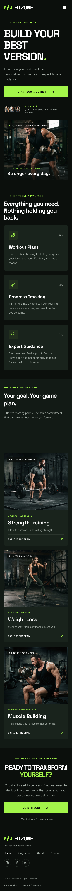

# FitZone – Fitness Landing Page

**Responsive fitness platform landing page designed using Figma.**

FitZone is a modern fitness platform concept designed to motivate users to achieve their fitness goals through personalized workout plans, progress tracking, and expert guidance.

## Design Overview

- **Platform:** Figma
- **Design Type:** Responsive Landing Page
- **Desktop Frame:** 1440px
- **Mobile Frame:** 390px
- **Design Theme:** Dark with Lime Green Accents
- **Heading Font:** Space Grotesk
- **Body Font:** Inter

## Screenshots

### Desktop Design

### Mobile Design

## Tools & Technologies

- Figma
- Auto Layout
- UI/UX Design
- Responsive Design
- Components and Styles

## 🔗 Figma Design

[View the FitZone Design in Figma]([PASTE_YOUR_FIGMA_LINK_HERE](https://www.figma.com/design/9htBucLL6diBtdNhmzOusv/FitZone-%E2%80%93-Fitness-Landing-Page?node-id=7-1209&t=eWGNO7yLGg2kx1Bp-1))

## Author

**Vyom Rana**

---

*This project was created as part of an individual UI/UX design assignment.*
